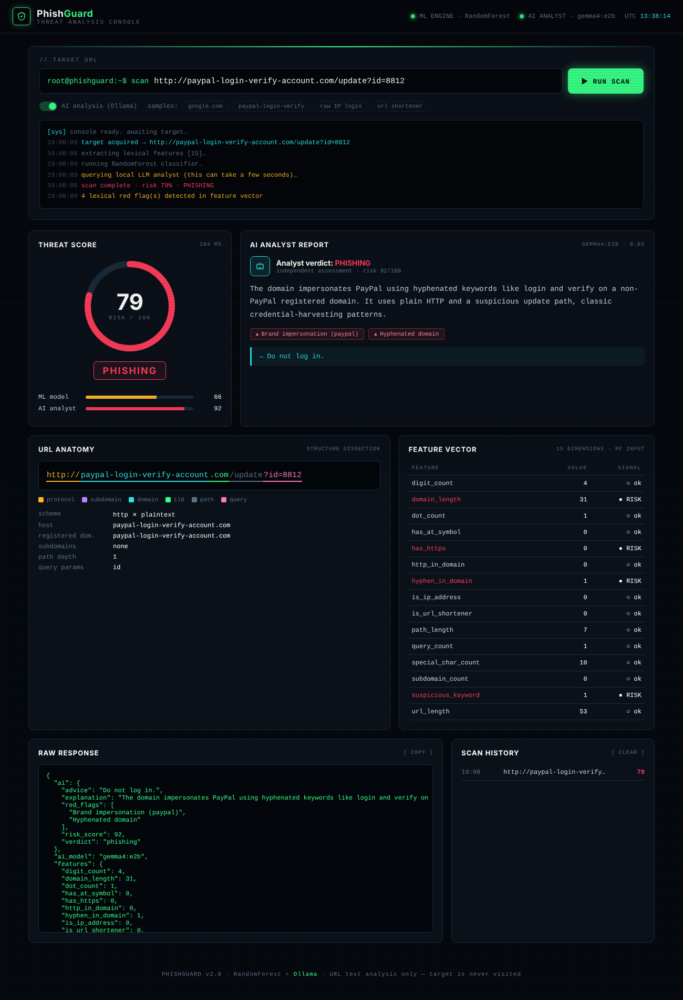

# 🛡️ CyberSage AI

**AI-powered phishing URL detection — Machine Learning + a local LLM security analyst.**

CyberSage AI analyses a URL in two ways at once: a **Random Forest** model scores it from 15 lexical features, and a **local LLM running in Ollama** reads it like a security analyst — spotting brand impersonation, typosquatting and other phishing tricks — then explains its verdict in plain English. Everything runs on your own machine; no URL is ever sent to a cloud API, and the target site is never visited.

<p align="center">
  
</p>

---

## 🚀 Features

- 🤖 **Hybrid detection** — final risk score blends the ML model (50%) and the AI analyst (50%)
- 🧠 **AI Analyst Report** — verdict, risk score, red flags and advice from a local LLM (default: `gemma4:e2b`)
- 🎯 **Threat gauge** — animated 0–100 risk score with Safe / Suspicious / Phishing verdict
- 🔬 **URL Anatomy** — colour-coded breakdown of protocol, subdomain, domain, TLD, path and query
- 📊 **Feature Vector** — all 15 features the Random Forest sees, with risky values highlighted
- 🖥️ **SOC-style console UI** — terminal input, live scan log, raw JSON view, scan history
- 🔌 **REST API** — `/api/predict` and `/api/health` for automation
- 🛟 **Graceful fallback** — if Ollama is offline, it keeps working with the ML model alone
- 🔒 **Private by design** — the LLM runs locally; URLs never leave your machine

---

## 🧠 How It Works

```
              ┌──────────────────────┐
  URL ──────► │ Feature extraction   │──► Random Forest ──► ML score ──┐
              │ (15 lexical features)│                                 │
              └──────────────────────┘                                 ├──► Final risk score
                                                                       │    + verdict
  URL + ML score ─────────────► Ollama LLM analyst ──► AI score ───────┘    + explanation
                                (gemma4:e2b)            + red flags
```

| Final score | Verdict |
|---|---|
| 0 – 39 | ✅ Safe |
| 40 – 74 | ⚠️ Suspicious |
| 75 – 100 | ❌ Phishing |

**Features used by the ML model:** URL length, dot count, HTTPS, raw IP address, `@` symbol, hyphen in domain, subdomain count, `http` in domain, path length, digit count, special characters, suspicious keywords (login, verify, bank…), domain length, URL shortener, query count.

---

## 🛠️ Tech Stack

| Layer | Tools |
|---|---|
| Backend | Python, Flask |
| Machine Learning | Scikit-learn (Random Forest), Pandas, Joblib |
| AI / LLM | Ollama, Gemma (any Ollama model works) |
| Frontend | HTML, CSS, JavaScript |

---

## 📁 Project Structure

```
cybersage-ai/
├── app.py                 # Flask app, scoring logic, API routes
├── ollama_client.py       # Ollama LLM analyst integration
├── feature_extraction.py  # 15 lexical URL features
├── train_model.py         # Trains the Random Forest
├── model.pkl              # Trained model
├── dataset/
│   └── phishing_data.csv
├── templates/
│   └── index.html         # CyberSage AI console UI
├── images/                # Old screenshots
├── cybersage-console.png  # README screenshot
├── requirements.txt
└── Procfile
```

---

## ⚙️ Installation

### 1. Install Ollama and a model
Download Ollama from [ollama.com](https://ollama.com), then:
```bash
ollama pull gemma4:e2b
```

### 2. Clone and set up
```bash
git clone https://github.com/itspranayjain/cybersage-ai.git
cd cybersage-ai
python3 -m venv venv
source venv/bin/activate        # Windows: venv\Scripts\activate
pip install -r requirements.txt
```

### 3. Run
```bash
python app.py
```
Open **http://localhost:10000**

> If the header shows *AI ANALYST (offline)*, start Ollama with `ollama serve`.

### Configuration (optional)

| Variable | Default | Purpose |
|---|---|---|
| `OLLAMA_MODEL` | `gemma4:e2b` | Any model from `ollama list` |
| `OLLAMA_HOST` | `http://localhost:11434` | Ollama server address |
| `OLLAMA_TIMEOUT` | `60` | Seconds to wait for the LLM |

```bash
export OLLAMA_MODEL=llama3.2
python app.py
```

---

## 🔌 API

**Scan a URL**
```bash
curl -X POST http://localhost:10000/api/predict \
     -H "Content-Type: application/json" \
     -d '{"url": "http://paypal-login-verify-account.com/update", "use_ai": true}'
```

**Response**
```json
{
  "url": "http://paypal-login-verify-account.com/update",
  "result": "❌ Phishing (High Risk)",
  "final_score": 79.0,
  "ml_score": 66.0,
  "ai": {
    "verdict": "phishing",
    "risk_score": 92,
    "red_flags": ["Brand impersonation (paypal)", "Hyphenated domain"],
    "explanation": "The domain impersonates PayPal using keywords like login and verify...",
    "advice": "Do not enter any credentials on this site."
  },
  "ai_model": "gemma4:e2b",
  "features": { "url_length": 53, "has_https": 0, "...": "..." },
  "timing_ms": { "ml": 12.4, "ai": 2840.1 }
}
```

**Health check**
```bash
curl http://localhost:10000/api/health
```

---

## 🧪 Try These

| URL | Expected |
|---|---|
| `https://www.google.com` | ✅ Safe |
| `http://paypal-login-verify-account.com/update?id=8812` | ❌ Phishing |
| `http://192.168.4.21/secure/bank/login.php` | ❌ Phishing |
| `http://bit.ly/3xFree-Gift` | ⚠️ Suspicious |

---

## ⚠️ Disclaimer

CyberSage AI is an educational cybersecurity project. It analyses URL text only and can make mistakes — always verify suspicious links through official channels before trusting or reporting them.

---

## 👤 Author

**Pranay Jain** — [@itspranayjain](https://github.com/itspranayjain)

⭐ If you found this useful, consider starring the repo!
