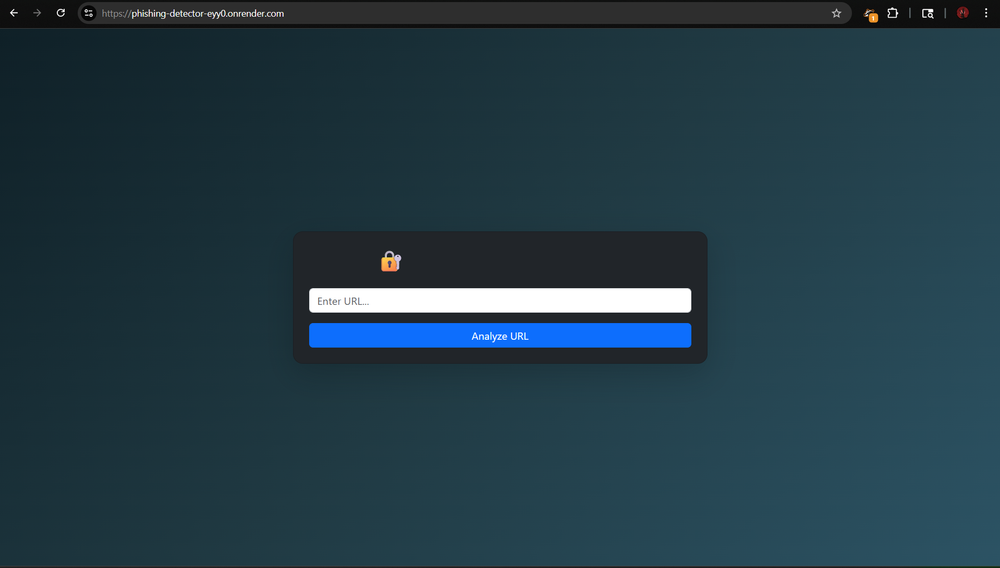
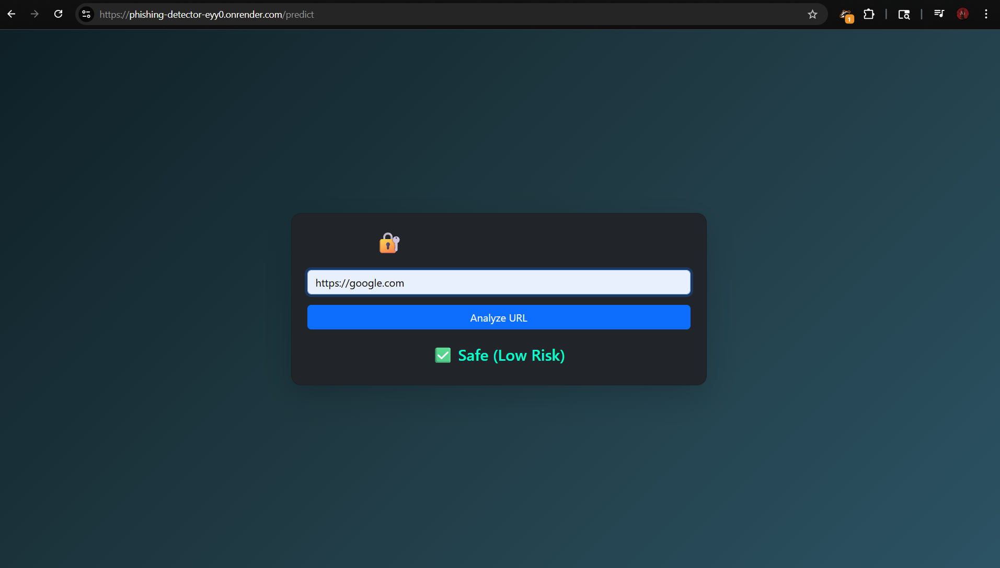
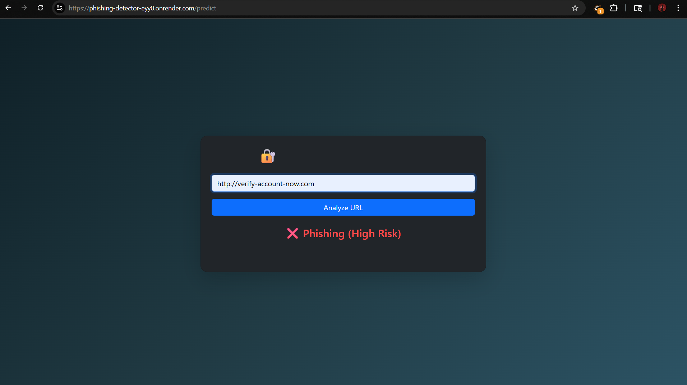

# 🛡️ CyberSage AI — Phishing Detection System

A Machine Learning-based web application that detects whether a given URL is Safe, Suspicious, or Phishing in real time.

🌐 **Live Demo:** https://phishing-detector-eyy0.onrender.com/

---

## 🚀 Features

- 🔍 URL-based feature extraction  
- 🤖 Machine Learning model (Random Forest)  
- 🌐 Flask web interface  
- ⚡ Real-time prediction  
- 📊 Confidence score display  
- 🔗 API endpoint for automation  
- 🧠 AI analyst via **Ollama** (local LLM) — explains *why* a URL is risky, lists red flags, and blends its score with the ML model

---

## 🧠 How It Works

1. User enters a URL  
2. System extracts features (length, HTTPS, keywords, etc.)  
3. Features are passed to ML model  
4. Model predicts:
   - ✅ Safe  
   - ⚠️ Suspicious  
   - ❌ Phishing  

---

## 🛠️ Tech Stack

- Python  
- Flask  
- Scikit-learn  
- Pandas  
- HTML, CSS (Bootstrap)  

---

## 📸 Screenshots





## 📁 Project Structure


---

## ⚙️ Installation

```bash
git clone https://github.com/itspranayjain/phishing-detector.git
cd phishing-detector
pip install -r requirements.txt
python app.py


---

## 🤖 AI Analysis with Ollama

The Random Forest gives a fast score; a local LLM (via [Ollama](https://ollama.com)) reads the URL like a security analyst — spotting brand impersonation, typosquatting, shady TLDs — and explains its verdict in plain English. Final score = 50% ML + 50% AI. If Ollama isn't running, the app falls back to ML only.

```bash
# 1. Install Ollama from https://ollama.com, then:
ollama pull gemma4:e2b
# 2. Run the app (Ollama runs on localhost:11434 automatically)
python app.py
```

Optional settings: `OLLAMA_MODEL` (default `gemma4:e2b`), `OLLAMA_HOST` (default `http://localhost:11434`), `OLLAMA_TIMEOUT` (default 60s).

### API
```bash
curl -X POST http://localhost:10000/api/predict -H "Content-Type: application/json" \
     -d '{"url": "http://paypal-login-verify.com", "use_ai": true}'
```
`GET /api/health` shows whether Ollama is reachable.
